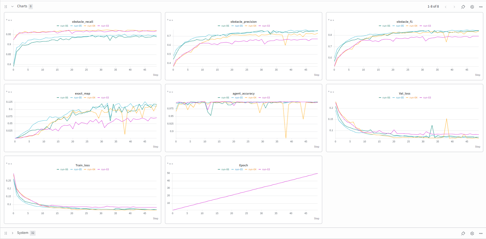
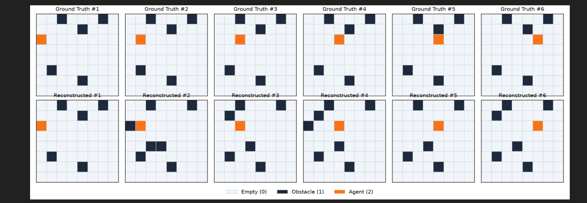
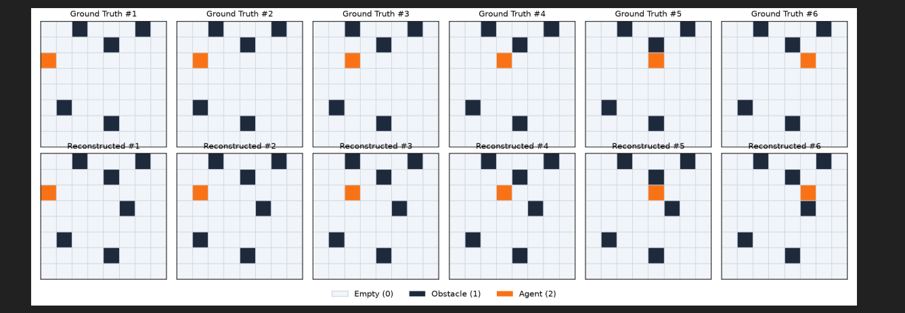

# World Model Grid

Môi trường grid 8×8 nhỏ để học và thử nghiệm world model cho bài toán học tăng cường. Mục tiêu hiện tại là giúp agent sống sót lâu nhất có thể bằng cách tránh vật cản và biên lưới.

## Nguồn cảm hứng

Ý tưởng được tham khảo từ bài báo:

> David Ha and Jürgen Schmidhuber. “World Models.” arXiv preprint arXiv:1803.10122 (2018). https://doi.org/10.48550/arXiv.1803.10122

- [Bản ghi arXiv](https://arxiv.org/abs/1803.10122)
- [Bản trình bày tương tác](https://worldmodels.github.io/)

Đây là project học tập độc lập; code hiện tại không tái tạo kiến trúc hoặc kết quả thực nghiệm của bài báo.

## Trạng thái dự án

- `GridEnv8x8` định nghĩa môi trường, state, action, reward, va chạm và giới hạn bước.
- `collect_data.py` tạo dataset train hoặc validation bằng cách trộn policy ngẫu nhiên với random walk tránh nguy hiểm ở bước kế tiếp.
- `model_v.py` có một autoencoder MLP để học mã hóa và tái tạo trạng thái dạng grid. Phần này mới học tái tạo state độc lập; chưa dự đoán chuyển trạng thái theo action.
- `model_m.py`, `dream_train.py` và `evaluate.py` hiện chưa được triển khai.

## Lựa chọn thiết kế của Model V

| Lựa chọn | Lý do | Trạng thái |
| --- | --- | --- |
| CrossEntropy theo từng ô | Mỗi ô thuộc đúng một trong ba lớp: trống, vật cản hoặc agent. Decoder xuất logits cho ba lớp tại mỗi ô, nên đây là bài toán phân loại đa lớp theo pixel. | Đang dùng trong train và validation. |
| Class weights nghịch đảo tần suất | `weight_distribution()` đặt trọng số theo tần suất nhãn trong từng batch: lớp ít gặp chịu loss lớn hơn. Trọng số đá không cố định ở 7×; tỷ lệ đá/trống xấp xỉ số ô trống chia số ô đá, nên thay đổi theo batch. Lớp agent còn hiếm hơn và cũng nhận trọng số cao. | Một lần validation ghi nhận obstacle precision 0.7142, recall 0.9695, F1 0.8225 và exact-map 0.0937. Đây là kết quả của một lần chạy; chưa đủ để kết luận class weights là nguyên nhân duy nhất gây dự đoán dư đá. |
| Latent dimension = 16 | Observation có 3×8×8 = 192 giá trị. Encoder nén qua hidden 64 xuống vector 16 chiều; decoder tái tạo logits từ vector này. Đây là bottleneck thử nghiệm ban đầu. | Chưa so sánh có hệ thống với kích thước latent khác, nên chưa xem 16 là tối ưu. |
| Adam, learning rate 0.0015, batch size 256, 50 epochs | Cấu hình hiện tại để chạy baseline; loss train/validation được log qua Weights & Biases và checkpoint tốt nhất được chọn theo validation loss. | Các giá trị cần tiếp tục đánh giá trên cùng validation set. |

Model V hiện là autoencoder xác định, chưa phải VAE: code không dự đoán phân phối latent hay dùng KL loss.

## Thí nghiệm trọng số vật cản: Runs 3–6

Runs 3–4 giữ nguyên class weight của vật cản; Runs 5–6 dùng căn bậc hai của trọng số này. Nhóm Runs 5–6 sinh ít đá giả hơn và có `obstacle_f1` nhỉnh hơn một chút, nhưng obstacle recall thấp hơn. Nói cách khác, giảm trọng số giúp mô hình thận trọng hơn khi gán một ô trống thành đá, song cũng làm tăng nguy cơ bỏ sót đá thật.

| Nhóm run | Class weight vật cản | Quan sát |
| --- | --- | --- |
| Runs 3–4 | Giữ nguyên | Obstacle recall cao. Run 4 trong các ví dụ tái tạo bắt được các đá thật, đồng thời dự đoán một số ô trống thành đá giả. |
| Runs 5–6 | Lấy căn bậc hai | Ít đá giả hơn và `obstacle_f1` cao hơn nhẹ; Run 6 có ví dụ tái tạo sai hoặc bỏ sót đá thật. |



*Biểu đồ theo epoch của obstacle recall, precision, F1, exact map, agent accuracy, validation loss và train loss.*

Hai ảnh dưới đây so sánh ground truth với reconstruction của Run 6 và Run 4. Đây là các ví dụ minh họa; biểu đồ W&B phía trên thể hiện xu hướng trên validation set.

| Run 6 — class weight vật cản đã lấy căn bậc hai | Run 4 — giữ nguyên class weight vật cản |
| --- | --- |
|  |  |

### Lựa chọn hiện tại

Tôi chọn **giữ nguyên class weight vật cản** (nhóm Runs 3–4), dù nhóm Runs 5–6 ít sinh đá giả hơn và có `obstacle_f1` cao hơn một chút. Với mục tiêu sống sót lâu nhất, bỏ sót đá thật nguy hiểm hơn dự đoán thừa đá: đá giả có thể khiến một bộ lập kế hoạch tương lai né một ô trống, còn bỏ sót đá thật có thể khiến nó chọn hành động va chạm và kết thúc episode. Vì vậy, quyết định hiện tại ưu tiên obstacle recall hơn precision/F1 cao hơn một chút.

## Luật môi trường

- Lưới có kích thước 8×8, với 5–10 vật cản tĩnh và một agent ở các ô khác nhau.
- Agent có bốn hành động: lên, xuống, trái và phải.
- Mỗi bước đi an toàn nhận reward `+1`.
- Đâm vật cản hoặc đi ra ngoài lưới kết thúc episode (`terminated=True`) và nhận reward `-10`. Agent giữ nguyên vị trí ở bước va chạm.
- Nếu agent còn sống sau 100 bước, episode bị dừng do giới hạn (`truncated=True`), không phải do agent chết (`terminated=False`).

Observation là mảng `float32` có shape `(3, 8, 8)` theo thứ tự channel-first:

| Channel | Ý nghĩa |
| --- | --- |
| 0 | Ô trống |
| 1 | Vật cản |
| 2 | Agent |

## Cài đặt

Cần Python 3.14 trở lên và [uv](https://docs.astral.sh/uv/). Từ thư mục gốc repo:

```bash
uv sync
```

## Chạy test

```bash
uv run pytest
```

## Thu thập dữ liệu

Dataset không được commit vào Git: thư mục `data/` cùng các file `.npz` và `.npy` được bỏ qua trong `.gitignore`. Tạo thư mục đích nếu chưa có:

```bash
mkdir -p data
```

Tạo 100.000 episode train:

```bash
uv run python -m world_model_grid.collect_data train
```

Tạo 10.000 episode validation:

```bash
uv run python -m world_model_grid.collect_data val
```

Trong mỗi split, 70% episode chọn ngẫu nhiên giữa cả bốn hướng; 30% còn lại chọn ngẫu nhiên trong các hướng không va chạm ngay ở bước kế tiếp. Seed của train và validation được tách riêng. Dataset lần lượt được lưu tại `data/train_dataset.npz` và `data/val_dataset.npz`.

Mỗi episode có độ dài khác nhau nên các trường được lưu thành mảng NumPy `dtype=object`. Khi nạp bằng NumPy cần bật pickle:

```python
import numpy as np

with np.load("data/train_dataset.npz", allow_pickle=True) as data:
    states = data["states"]
```

Dataset giữ các trường `states`, `actions`, `rewards`, `next_states` và `terminated`. Cờ `truncated` dùng để dừng episode khi thu thập nhưng không được lưu. Collector giữ toàn bộ split trong RAM trước khi ghi file; hãy đảm bảo máy có đủ bộ nhớ và dung lượng đĩa.

## Cấu trúc mã nguồn

- `src/world_model_grid/config.py`: cấu hình môi trường, đường dẫn dữ liệu và siêu tham số Model V.
- `src/world_model_grid/env.py`: môi trường grid.
- `src/world_model_grid/collect_data.py`: tạo và lưu dataset train/validation.
- `src/world_model_grid/model_v.py`: dataset PyTorch, mô hình tái tạo state, train/validation loop và lưu checkpoint.
- `tests/test_env.py`: test luật môi trường hiện tại.
