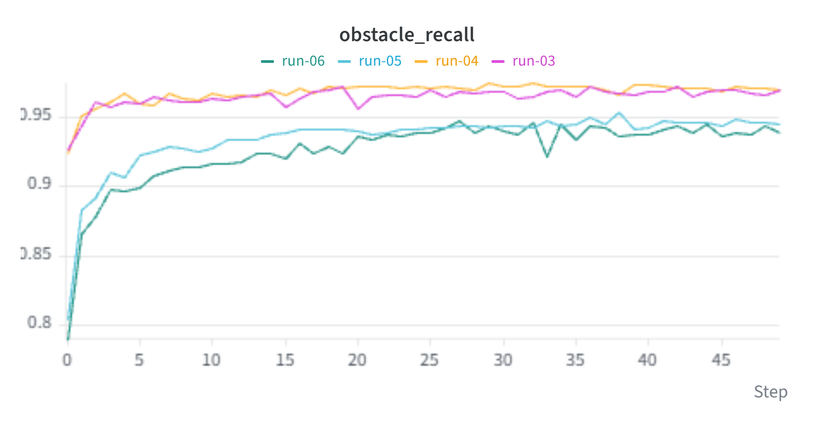
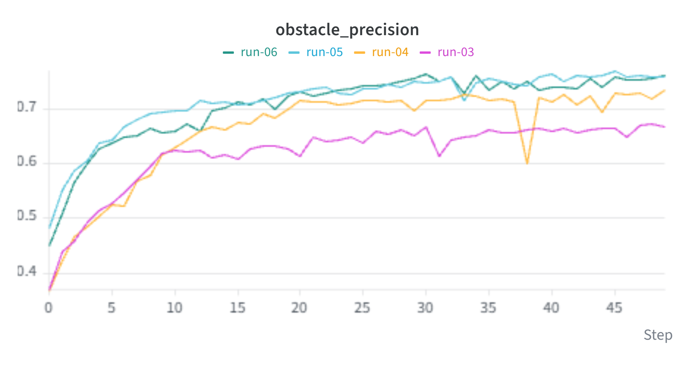
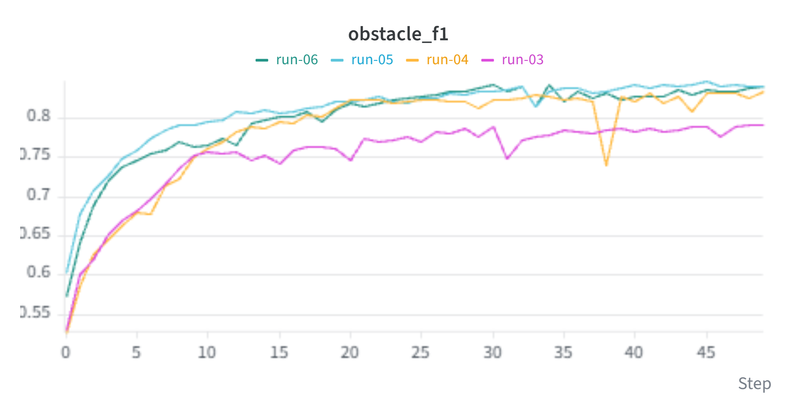
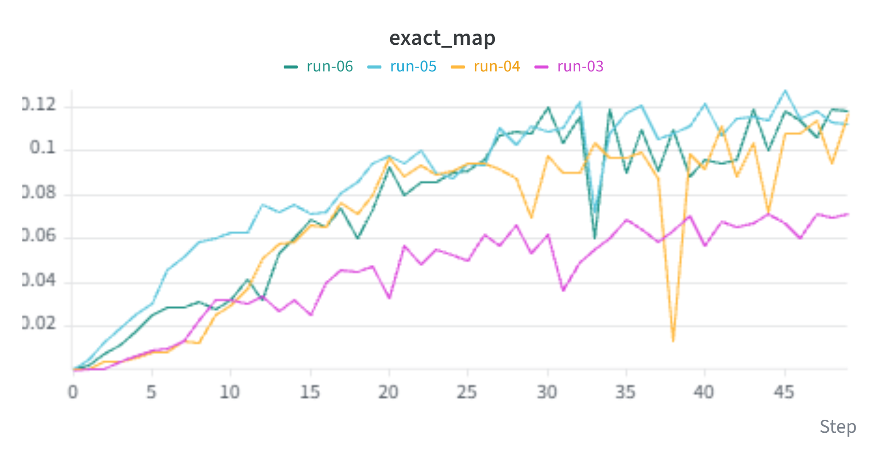
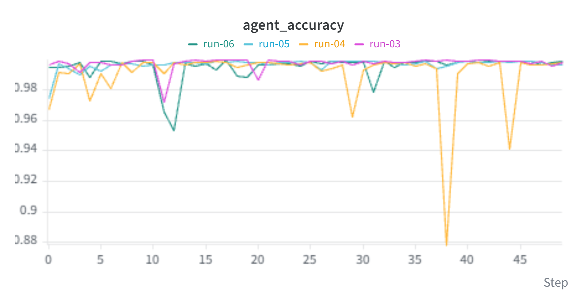
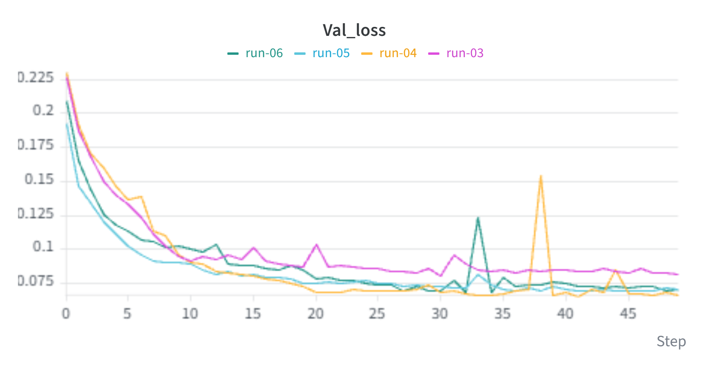
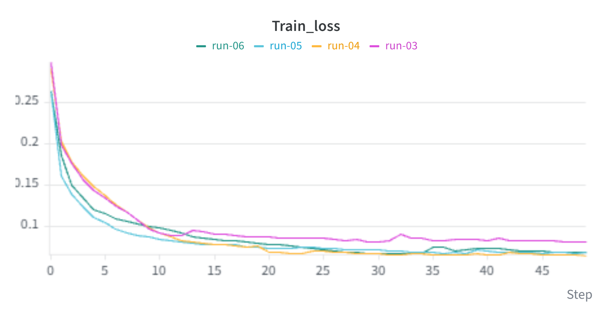

# So sánh trọng số vật cản: Runs 3–6

Tài liệu này ghi lại thử nghiệm giảm class weight của lớp vật cản và lý do chọn cấu hình hiện tại. Reconstruction minh họa một số state validation; các biểu đồ W&B cho thấy diễn biến metric theo epoch.

## Thiết lập

- **Runs 3–4:** giữ nguyên class weight của vật cản, không lấy căn bậc hai.
- **Runs 5–6:** dùng căn bậc hai của class weight vật cản để giảm độ chênh lệch so với trọng số gốc.
- Màu đường: run-03 hồng, run-04 cam, run-05 xanh dương nhạt, run-06 xanh ngọc.

## Tổng kết

| Nhóm | Class weight vật cản | Obstacle recall | Đá giả / precision | Obstacle F1 | Nhận xét |
| --- | --- | --- | --- | --- | --- |
| Runs 3–4 | Giữ weight gốc | Cao hơn | Nhiều đá giả hơn | Thấp hơn một chút | Run 4 bắt được đá thật trong các mẫu minh họa nhưng dự đoán thêm đá ở ô trống. |
| Runs 5–6 | Lấy căn bậc hai | Thấp hơn | Ít đá giả hơn / precision cao hơn | Nhỉnh hơn một chút | Run 6 có mẫu reconstruction bỏ sót hoặc đặt sai đá thật. |

## Biểu đồ W&B

### Obstacle recall

*Chú thích: Runs 3–4 giữ recall cao hơn; Runs 5–6 nằm thấp hơn trong phần lớn quá trình.*

**Kết luận:** Weight gốc bắt được nhiều đá thật hơn; căn bậc hai làm recall giảm.

### Obstacle precision

*Chú thích: Runs 5–6 đạt precision cao hơn các run dùng weight gốc.*

**Kết luận:** Căn bậc hai giảm dự đoán đá ở ô trống, tức giảm số “đá ma”.

### Obstacle F1

*Chú thích: Runs 5–6 nhỉnh hơn nhẹ; Run 4 vẫn khá gần nhóm này.*

**Kết luận:** F1 nghiêng nhẹ về căn bậc hai, nhưng chênh lệch không lớn và không phản ánh riêng mức độ nguy hiểm của từng loại lỗi.

### Exact map

*Chú thích: Runs 5–6 kết thúc cao hơn Run 3; Run 4 cũng tiến gần nhóm này.*

**Kết luận:** Căn bậc hai có lợi thế trên biểu đồ này, nhưng kết quả giữa các run dao động và chưa đủ để khẳng định lợi thế tổng quát.

### Agent accuracy

*Chú thích: Các run nhìn chung giữ agent accuracy gần mức cao; Run 4 có vài lần tụt mạnh.*

**Kết luận:** Metric này không phân tách rõ hai cách đặt weight; các điểm tụt của Run 4 cần được xem như biến động riêng của run.

### Validation loss

*Chú thích: Loss giảm ở mọi run; Run 3 duy trì cao hơn về cuối và một số run có spike ngắn.*

**Kết luận:** Không thấy căn bậc hai thắng ổn định trên validation loss; riêng loss không quyết định lựa chọn weight cho an toàn.

### Train loss

*Chú thích: Train loss giảm nhanh ở mọi run; Run 3 cao hơn các run còn lại về cuối.*

**Kết luận:** Cả hai cách weight đều học được; train loss thấp hơn không bảo đảm bắt đủ đá thật.

## Ví dụ reconstruction

### Run 6 — class weight đã lấy căn bậc hai

*Chú thích: Run 6 sinh ít đá giả hơn trong các mẫu so sánh.*

**Kết luận:** Một số vị trí đá thật vẫn bị tái tạo sai hoặc bỏ sót.

### Run 4 — giữ nguyên class weight

*Chú thích: Run 4 dự đoán thừa đá tại một số ô trống.*

**Kết luận:** Trong các mẫu minh họa, Run 4 bắt được các đá thật dù có thêm đá giả.

## Quyết định

Hiện tại chọn **giữ nguyên class weight, không lấy căn bậc hai**. Với mục tiêu sau cùng là giúp agent sống sót:

- **Đá giả (false positive):** có thể khiến planner tương lai tránh một ô thực ra trống, làm đường đi kém thuận tiện.
- **Bỏ sót hoặc đặt sai đá thật (false negative):** có thể khiến planner tưởng ô nguy hiểm là an toàn và chọn hành động va chạm.

Vì vậy, ưu tiên recall cao hơn precision hoặc F1 nhỉnh hơn một chút. Đây là lựa chọn theo chi phí lỗi của bài toán, không phải khẳng định weight gốc tốt hơn trong mọi trường hợp.

## Giới hạn diễn giải

Các chart và reconstruction ở đây minh họa các run hiện có; chưa phải so sánh nhiều seed. Cần đánh giá policy sống sót thực tế trước khi kết luận mức cải thiện tổng quát. Model V hiện mới tái tạo observation, chưa điều khiển agent, nên lợi ích an toàn ở trên là mục tiêu thiết kế cho planner tương lai chứ chưa phải kết quả survival đã đo.

[Quay lại README](../../README.md)
