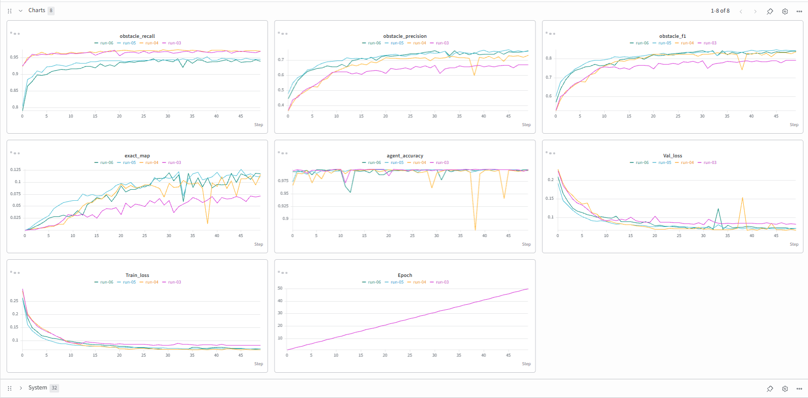
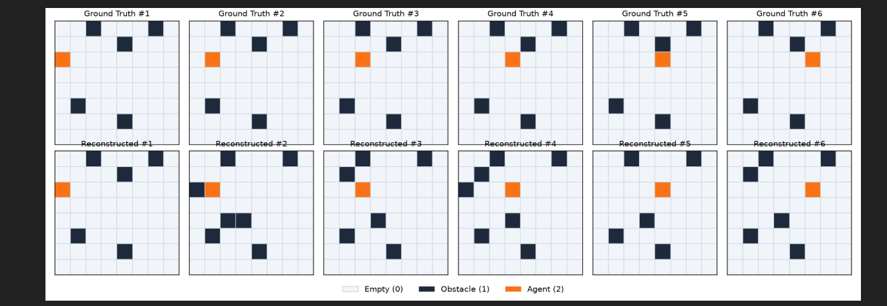
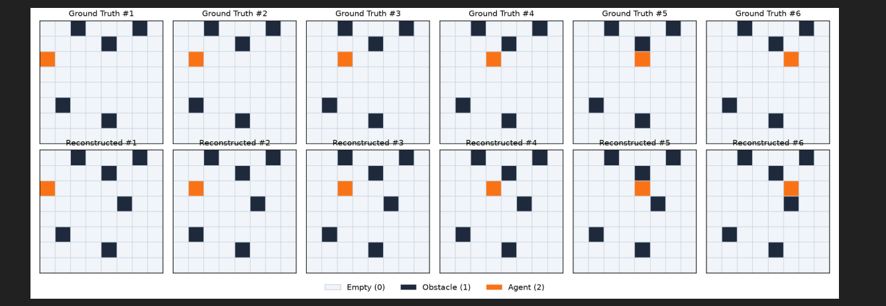

# So sánh trọng số vật cản: Runs 3–6

Tài liệu này ghi lại thử nghiệm giảm class weight của lớp vật cản và lý do chọn cấu hình hiện tại. Các ảnh reconstruction minh họa một số state validation; xu hướng trên nhiều epoch được thể hiện trong log W&B.

## Thiết lập

- **Runs 3–4:** giữ nguyên class weight của vật cản, không lấy căn bậc hai.
- **Runs 5–6:** dùng căn bậc hai của class weight vật cản để giảm độ chênh lệch so với trọng số gốc.

Các metric trong biểu đồ gồm obstacle precision, obstacle recall, obstacle F1, exact map, agent accuracy, validation loss và train loss.

## Tổng kết

| Nhóm | Cách đặt weight | Obstacle recall | Đá giả | Obstacle F1 | Nhận xét |
| --- | --- | --- | --- | --- | --- |
| Runs 3–4 | Weight gốc | Cao hơn | Nhiều hơn | Thấp hơn một chút | Bắt được các đá thật trong reconstruction Run 4; có dự đoán thêm đá ở ô trống. |
| Runs 5–6 | Căn bậc hai weight | Thấp hơn | Ít hơn | Cao hơn một chút | Reconstruction Run 6 có trường hợp bỏ sót hoặc đặt sai đá thật. |

Biểu đồ cho thấy trade-off giữa precision và recall: giảm trọng số giúp hạn chế dự đoán đá ở ô trống, nhưng đi kèm recall thấp hơn. F1 của vật cản ở nhóm Runs 5–6 nhỉnh hơn nhẹ. Không ghi số chính xác ở đây vì ảnh log không cung cấp bảng giá trị cuối cùng có thể trích xuất đáng tin cậy.

## Ví dụ reconstruction

### Run 6 — class weight đã lấy căn bậc hai

Run 6 sinh ít đá giả hơn, nhưng một số vị trí đá thật bị tái tạo sai hoặc bỏ sót.

### Run 4 — giữ nguyên class weight

Run 4 tái tạo được các đá thật trong những mẫu minh họa, đổi lại có thêm đá giả tại một số ô trống.

## Quyết định

Hiện tại chọn **giữ nguyên class weight, không lấy căn bậc hai**. Với mục tiêu sau cùng là giúp agent sống sót:

- **Đá giả (false positive):** có thể khiến planner tương lai tránh một ô thực ra trống, làm đường đi kém thuận tiện.
- **Bỏ sót hoặc đặt sai đá thật (false negative):** có thể khiến planner tưởng ô nguy hiểm là an toàn và chọn hành động va chạm.

Vì vậy, ưu tiên recall cao hơn precision hoặc F1 nhỉnh hơn một chút. Đây là lựa chọn theo chi phí lỗi của bài toán, không phải khẳng định weight gốc tốt hơn trong mọi trường hợp.

## Giới hạn diễn giải

Các reconstruction là ví dụ định tính, không đại diện cho toàn bộ validation set. Log hiện có cho thấy xu hướng của các run; cần so sánh nhiều seed và đánh giá policy sống sót thực tế trước khi kết luận mức cải thiện tổng quát. Model V hiện mới tái tạo observation, chưa điều khiển agent, nên lợi ích an toàn ở trên là mục tiêu thiết kế cho planner tương lai chứ chưa phải kết quả survival đã đo.

[Quay lại README](../../README.md)
